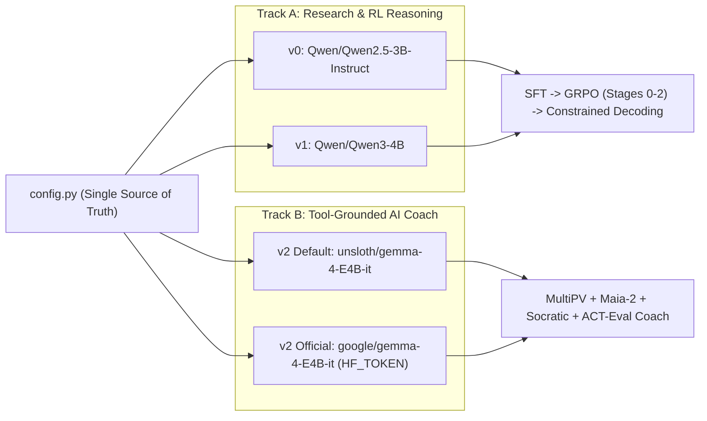
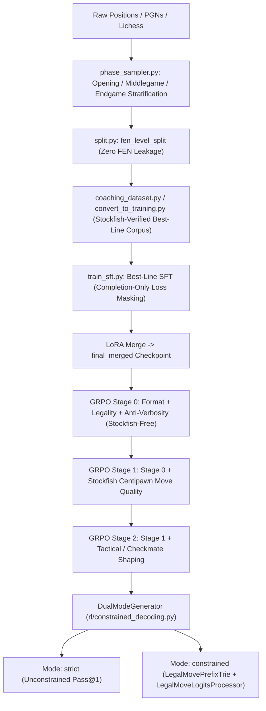
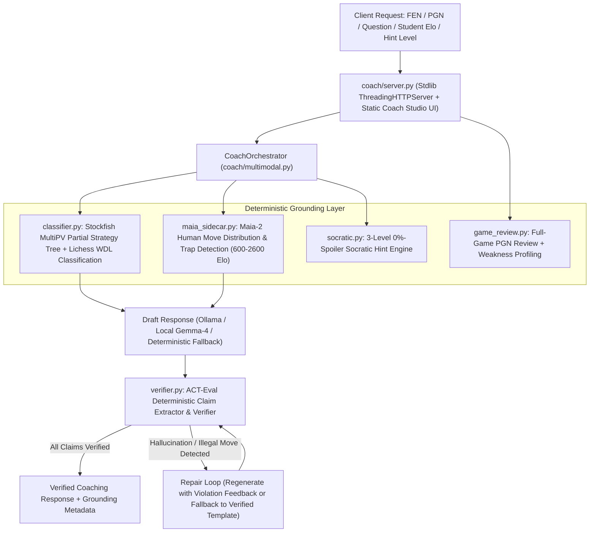
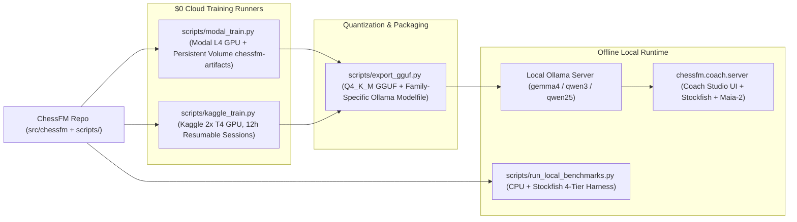

# ChessFM System Architecture

ChessFM is a two-track chess reasoning and tool-grounded coaching system. It separates **pure chess reasoning and reinforcement learning** (Track A) from **engine-verified, human-calibrated chess coaching** (Track B), sharing a unified configuration layer (`src/chessfm/config.py`), deterministic verification primitives, and a 4-tier evaluation harness.

---

## 1. Two-Track Model Strategy

All model identifiers, token budgets, prompt templates, and Stockfish parameters are defined in `src/chessfm/config.py`. Prompt construction (`build_chat_prompt`) delegates to `tokenizer.apply_chat_template` when available and falls back to ChatML for Qwen-2.5, ensuring identical prompt serialization across data conversion, SFT, GRPO, and evaluation.

| Track | Version | Model ID | Access | Role |
| :--- | :--- | :--- | :--- | :--- |
| Research & RL | `v0` | `Qwen/Qwen2.5-3B-Instruct` | Ungated | 3B reasoning baseline; ChatML fallback; fast SFT + GRPO iteration |
| Research & RL | `v1` | `Qwen/Qwen3-4B` | Ungated | 4B reasoning upgrade; native `<think>...</think>` reasoning alignment |
| AI Chess Coach | `v2` / `coach` | `unsloth/gemma-4-E4B-it` | Ungated (default) | Engine-grounded coaching verbalization, Socratic hints, Q&A |
| AI Chess Coach | `v2` (official) | `google/gemma-4-E4B-it` | Gated (`HF_TOKEN`) | Official upstream weights for Track B coaching |

**Design Invariants:**
- **Shared Token Budget**: `MAX_PROMPT_LENGTH = 512`, `MAX_COMPLETION_LENGTH = 512`, and `DEFAULT_MAX_NEW_TOKENS = MAX_COMPLETION_LENGTH`, preventing train/inference budget mismatch.
- **LoRA Defaults**: `LORA_R = 16`, `LORA_ALPHA = 32`, `MAX_SEQ_LENGTH = 2048`.
- **Optional ASCII Board Injection**: `make_prompt(fen, include_ascii=True)` inserts an 8x8 rank/file-labeled ASCII board directly into the user turn to strengthen spatial grounding on FEN-only inputs.

---

## 2. Training & Constrained Decoding Pipeline

Track A trains models to emit structured reasoning inside `<think>...</think>` followed by a legal UCI move. To prevent position memorization and adapter stacking drift, data splitting is enforced at the normalized board-FEN level, and LoRA weights are merged between SFT and GRPO.

### Pipeline Stages

1. **Phase-Balanced FEN Splits** (`data_generation/phase_sampler.py`, `training/split.py`):
   - Positions are classified into `opening`, `middlegame`, and `endgame` buckets and normalized via `normalize_board_fen` (board placement, active color, castling, en passant) before partitioning via `fen_level_split` so identical positions never cross train/validation boundaries.
2. **Best-Line SFT with Completion-Only Loss Masking** (`training/train_sft.py`, `data_generation/coaching_dataset.py`):
   - Generates deterministic, Stockfish-verified best-line reasoning and move targets at `$0` external API cost (filtering moves exceeding `MAX_CENTIPAWN_LOSS = 200`).
   - Masks prompt tokens from the cross-entropy loss so gradients update strictly on the `<think>...</think>\n<uci><eos>` completion span.
   - Merges LoRA adapters into a standalone `final_merged` checkpoint prior to RL.
3. **Staged GRPO** (`rl/train_grpo.py`, `rl/rewards.py`):
   - Uses `GRPO_NUM_GENERATIONS = 8`, `GRPO_TEMPERATURE = 1.0`, `GRPO_BETA = 0.04`.
   - **Stage 0** (Stockfish-free): enforces `<think>...</think>` syntax, strict UCI move legality, and bounded reasoning length.
   - **Stage 1 & Stage 2**: fail fast if Stockfish is unavailable; add Stockfish depth-10 centipawn quality rewards and tactical/checkmate shaping.
4. **Prefix-Trie Constrained Decoding** (`rl/constrained_decoding.py`):
   - `LegalMovePrefixTrie` indexes token-ID sequences for all legal UCI moves in the current FEN (including `""`, `"\n"`, and `" "` leading prefixes).
   - `LegalMoveLogitsProcessor` leaves token generation inside `<think>...</think>` unconstrained; immediately after the `</think>` subsequence is emitted, all token logits outside the active trie branch are masked to `-inf`, guaranteeing 100% legal UCI moves.
   - `DualModeGenerator` exposes both `strict` (pure-LLM Pass@1) and `constrained` modes, plus optional Best-of-N reranking.

---

## 3. Tool-Grounded AI Chess Coach Architecture

Track B eliminates LLM chess hallucination by decoupling **symbolic computation** (Stockfish + `python-chess` + Maia-2) from **pedagogical verbalization** (LLM or deterministic template), wrapped in a deterministic claim verifier and repair loop.

### Core Components

- **MultiPV Partial Strategy Trees & WDL Classification** (`coach/classifier.py`):
  - Maps centipawns to win probability via the Lichess logistic formula (`50 + 50 * (2 / (1 + exp(-0.00368208 * cp)) - 1)`).
  - Labels moves (`Best`, `Excellent`, `Good`, `Inaccuracy`, `Mistake`, `Blunder`, `Missed Win`) using win-probability drop and centipawn loss thresholds.
  - Extracts MultiPV principal variations as structured Partial Strategy Trees for grounded verbalization.
- **Maia-2 Human-Elo Sidecar** (`coach/maia_sidecar.py`):
  - Predicts human move distributions across 11 Elo brackets (`600` through `2600` in 200-Elo steps) and detects Elo-specific tactical traps.
  - Uses official `maia2` neural weights when installed; otherwise falls back deterministically to a fast Elo-calibrated heuristic (+ optional Stockfish) and explicitly reports `backend: "calibrated_fallback"`.
- **3-Level 0%-Spoiler Socratic Hint Engine** (`coach/socratic.py`):
  - **Level 1 (Nudge)**: strategic theme or piece type only (zero square or move disclosure).
  - **Level 2 (Guided)**: tactical motif, threat, or target area (never exact move or both origin and destination squares).
  - **Level 3 (Solution)**: full verified SAN/UCI move and principal variation.
  - Enforced by `contains_move_spoiler` verification on Levels 1 and 2.
- **ACT-Eval Claim Verifier & Repair Loop** (`coach/verifier.py`, `coach/multimodal.py`):
  - Extracts atomic claims from free-form prose: UCI/SAN/contextual pawn moves, piece-on-square assertions, and check/checkmate assertions.
  - Verifies each claim deterministically against `python-chess` and optional Stockfish blunder checks (`MAX_CENTIPAWN_LOSS = 200`).
  - On violation, triggers a repair pass with explicit violation feedback or falls back to a 100% engine-verified coaching template.
- **Offline Coach Studio UI & Server** (`coach/server.py`, `coach/static/index.html`):
  - Zero-dependency `http.server.ThreadingHTTPServer` serving the interactive Coach Studio UI and REST endpoints for position analysis, Socratic hints, Q&A, PGN game review, and recurring weakness profiles.
  - Connects to a local Ollama endpoint (`OLLAMA_HOST`, `CHESSFM_OLLAMA_MODEL`) when configured, with automatic fallback to deterministic Stockfish + Maia-2 coaching.

---

## 4. 4-Tier Evaluation & \$0 Compute Architecture

### 4-Tier Evaluation Suite (`src/chessfm/eval/suite.py`, `scripts/run_local_benchmarks.py`)

Every claimed metric is backed by a reproducible CLI invocation (`python -m chessfm.eval.suite` or `scripts/run_local_benchmarks.py`) producing a structured JSON manifest with git revision, model identifier, decoding mode, and Stockfish depth.

| Tier | Scope | Core Metrics |
| :--- | :--- | :--- |
| **Tier 1** | Static Engine Metrics | Legal-move rate, `<think>...</think>` format adherence, ACPL, Move Accuracy Rate (MAR, `<= 50 cp`), mean WDL win-probability loss, exact puzzle accuracy |
| **Tier 2** | Board-State Probing (ChessQA) | Deterministic comprehension probes: side to move, piece on square, move legality, legal move count (overall & per-category accuracy) |
| **Tier 3** | Coaching Faithfulness (ACT-Eval) | Claim verification faithfulness rate (`verify_claims`) and Socratic L1/L2 spoiler rate (`contains_move_spoiler`, target `0.0%`) |
| **Tier 4** | Paired Color-Balanced Matches | Overall and White/Black W-D-L splits, 95% Wilson confidence interval (`wilson_ci`), estimated Elo (`estimated_elo`), fixed-depth opponent reproducibility |

### \$0 Compute & Local Deployment Topology

Training, evaluation, and offline serving are engineered to operate within free-tier cloud budgets and local consumer hardware:

- **Modal L4 Runner** (`scripts/modal_train.py`): supports `--track {v0, v1, v2, coach}` and `--task {smoke-pipeline, sft, grpo, eval, coach-eval, export-gguf}`, persisting checkpoints and evaluation manifests to the `chessfm-artifacts` volume.
- **Kaggle 2x T4 Runner** (`scripts/kaggle_train.py`): supports resumable checkpoints (`--resume`) across 12-hour session boundaries and auto-resolves Debian/Ubuntu Stockfish paths (`/usr/games/stockfish`).
- **GGUF & Ollama Export** (`scripts/export_gguf.py`): converts merged checkpoints via `llama.cpp` to quantized GGUF (e.g., `q4_k_m`) and emits model-family-specific Ollama `Modelfile` stop tokens (`<turn|>`, `<|turn>`, `<eos>` for `gemma4`; `<|im_end|>`, `<|im_start|>` for `qwen3` / `qwen25`).
