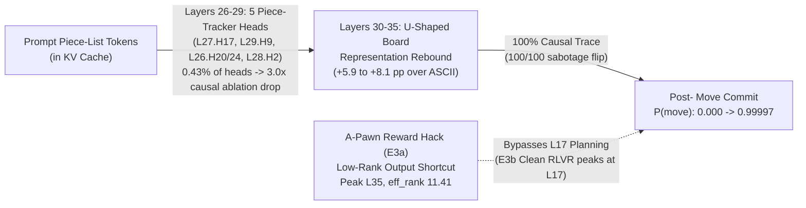

# Inside a 4B Chess Reasoning & Coaching Model: Post-Training, Reward Hacking, and Mechanistic Interpretability Under Verified Oracles

> **TL;DR:** Using chess as a deterministic ground-truth laboratory (`Stockfish 16` + `python-chess`, `0.00%` train/test board overlap), we post-trained `Qwen/Qwen3-4B` across both **chess playing** and **grounded AI chess coaching**, caught and fixed **two live Goodhart's Law reward hacks** (including an *"A-Pawn Hack"* where RLVR spammed `60.3%` a-file pawn pushes while boosting every naive dashboard metric), exposed a **`+231` Elo stateless draw mirage**, trained a local **`4B` (`2.50 GB` Q4_K_M) AI Chess Coach** that reaches **`92.0%` All-Clean (`100%` spoiler-free, `0%` slop)**—beating its **`6.5×` larger `Gemma-4-26B` teacher (`88.7%`)**—and opened the weights with **four mechanistic interpretability experiments**, discovering a **`0.43%`-of-heads Piece-Tracker circuit in Layers 26–29** (`3.0×` causal ablation drop vs. layer-matched random heads), an **output-layer rank-collapse signature (`L34–L35`) of reward hacking**, and a **linear Goodhart "Slop Vector"** that dials boilerplate slop monotonically from `0%` to `36%`.

---

## Key Empirical Findings

| Research Question | Experiment | Verified Outcome (`0.00%` Board Leakage) |
|---|---|---|
| **Board Representation & LoRA LR** | `E0` (ASCII, `lr=2e-5`) → `E1a` (Piece-List, `lr=2e-4`) | Strict legality **`21.0% → 63.5%` (`3.0×`)**; `piece_on_square` **`33.5% → 80.5%`** on the same `2.5K` rows. |
| **LoRA vs. Full Fine-Tuning** | `E2a` (All-Linear `r=64`, A100) vs. `E2b` (Full-FT, H100) | **`E2a` swept `E2b` on all 7 suites** (`66.2%` vs. `62.4%` legal, `21.4%` vs. `17.4%` puzzles, `45.2%` vs. `31.2%` ChessQA, `90%` English / `0%` leak), empirically confirming *LoRA Without Regret* at `20K` rows / `7M` tokens. |
| **Reward Hacking & Fix (Play)** | `E3a` (`wdl_loss`) → `E3b` (`sharp_wdl` DAPO) | Naive RLVR collapsed to **`60.3%` a-file pawn pushes** (`unique_moves: 528 → 206`). Quadratic `sharp_wdl` restored diversity (`443` moves, `1.5%` a-pawns), lifted strict legality **`+10.3 pp` (`76.5%`)**, MAR **`+3.0 pp`**, and **emergent CoT V2 accuracy `+10.0 pp` (`70.7%`) with zero CoT reward**. |
| **Exploration vs. Sharpening** | Stratified `pass@1..pass@8` (`N=200`, `k=8`, `T=0.7`) | `E3b` boosted legality (`68.6% → 75.6%`) and CoT faithfulness (`52.3% → 59.3%`) while narrowing `pass@8` (`43.5% → 34.0%`), matching Yue et al. (NeurIPS 2025). |
| **Eval Mirage Audit** | 200-game 5-anchor BT Elo (`std` vs. `--avoid-repetition`) | **`89.4%`** of `E2a` draws were stateless 3-fold repetitions, inflating BT Elo by **`+230.9` Elo** (`542.4 → 311.4`). De-biased `--avoid-repetition` reveals **`+27.3` Elo RLVR lift** (`E3b: 338.7`, plus first real wins vs. `Maia-1100`). |
| **Goodhart's Law & Real `4B` Coach** | 7-row `test_coach_300` + Verifier V1 vs. Strict V2 | Strict V2 exposed `Qwen3-0.6B` SFT collapsing `86.6% → 12.7%` V2+non-slop (`79.8%` slop). On `4B`, **`Arm A` Strict `V2-GRPO`** reached **`92.0%` All-Clean (`+3.3 pp` > `26B` Teacher, `+2.7 pp` > Weak `V1-GRPO` `Arm C`)**; **`Arm B` (`E3b → Coach`)** reached **`91.0%` All-Clean** with **`81.7%` tactical fact coverage (`+4.5 pp` deeper)**. |
| **David vs. Goliath (`4B` vs. `26B`)** | Zero-shot `Gemma-4-26B` vs. post-trained `Qwen3-4B` | `4B` beat `6.5×` larger `26B` on 900 Puzzles (**`21.4%` strict** vs. `0.22%` strict / `10.8%` lenient), 1,000 ChessQA (**`45.2%`** vs. `26.3%`), and 300 Coaching (**`92.0%`** vs. `88.7%`). |
| **Mechanistic Interpretability** | `INTERP #1`–`#4` on `Qwen3-4B` checkpoints | **Layers 26–29 Piece-Tracker circuit (`0.43%` of heads: `L27.H17`, `L29.H9`, `L26.H20/H24`, `L28.H2`)** drives a **Layer 30–35 board-state rebound** and causes a **`3.0×` causal ablation drop** (`-12.0 pp` vs. `-4.0 pp` random). A-Pawn Hack concentrates in **`L34–L35` with rank collapse (`12.8 → 11.4`)** vs. clean RLVR peaking at **`L17`**. Causal `<think>` sabotage flips **`100%`** of moves. |

---

## 1. Why Chess + Deterministic Oracles Is an Ideal Post-Training Lab

Most post-training evaluations rely on LLM-as-a-Judge scores that quietly share the blind spots of the models they grade. Chess eliminates judge noise completely:

1. **Exact Move & Eval Oracles:** Every candidate move has an exact legality bit (`python-chess`) and win-draw-loss (WDL) expected score (`Stockfish 16`, depth 10).
2. **Exact Prose Claim Verification (`ACT-Eval`):** Every natural-language chess claim inside `<think>...</think>` or a coaching response—piece locations (*"your knight on f3"*), captures, checks, attacks, castling, hanging pieces, and legal moves—can be parsed and verified deterministically against the board (`src/chessfm/coach/verifier.py`).
3. **Zero-Leakage Board Splitting:** Because transpositions and move-counter differences leak positions across naive string splits, every dataset in ChessFM is split by normalized 4-field board FEN (`normalize_board_fen` in `src/chessfm/data_generation/phase_sampler.py`).

### Data Hygiene Before Training: Catching 984 Chess960 Games
During Phase II corpus construction (`scripts/build_phase2_data.py`), strict `python-chess` validation caught **984 Chess960 (Fischer Random) games** embedded inside upstream PGN archives with non-standard castling rights. Filtering those out yielded **`143,220` valid standard positions** partitioned with **`0.00%` normalized-FEN overlap across all 27 split pairs**:
- Training pools: `sft_phase2_20k.jsonl` (mixed elite games, Lichess puzzles, and 5-category ChessQA), `rl_positions_40k.txt`, `rl_sharp_tactical.txt` (`20,000` sharp tactical positions), `coach_sft_v2_4500.jsonl` (`4,518` spotless V2 traces), and `coach_grpo_prompts_2k.jsonl`.
- Frozen test suites: `test_fens_1000.jsonl`, `test_puzzles_900.jsonl` (500 theme-balanced + 400 difficulty-stratified), `test_chessqa_1000.jsonl`, `test_coach_300.jsonl` (60 × 5 modes), `test_english_100.jsonl` (catastrophic-forgetting probe), and `test_openings_20.txt`.

---

## 2. Board Representation & *LoRA Without Regret* (`E0 → E1a → E1b → E2a → E2b`)

We started with `E0` (`Qwen/Qwen3-4B`, `2.5K` ASCII+FEN rows, LoRA `r=16`, `lr=2e-5`). It reached only `21.0%` strict move legality and `33.5%` `piece_on_square` probing accuracy. Two root causes jumped out immediately:
1. **Tokenization Hostility of ASCII Grids:** In an 8×8 ASCII diagram, determining which piece sits on `f6` forces BPE tokens to count dots and spaces across rows. Replacing ASCII with a **lossless Piece-by-Square Coordinate List** (`White: Kg1, Qe1, ... | Black: Kg8, Qd8, ...`, `render_piece_list` in `src/chessfm/config.py`) jumped zero-shot Base `Qwen3-4B` `piece_on_square` accuracy from **`12.5% → 40.0%`** before a single gradient step.
2. **LoRA Learning-Rate Scaling:** Following Schulman's *LoRA Without Regret* (2025), LoRA requires roughly `10×` higher learning rate than full fine-tuning (`2e-4` vs. `2e-5`) and benefits from adapting **all linear layers** (`q/k/v/o/gate/up/down_proj`).

On the **exact same `2.5K` rows** (`E0 → E1a`), switching to Piece-List + All-Linear `lr=2e-4` **tripled strict legality (`21.0% → 63.5%`)** and more than doubled `piece_on_square` (`33.5% → 80.5%`). Scaling to `20K × 2` mixed epochs (`E1b`) lifted 900 Puzzles `3.93×` (`4.67% → 18.33%`) and 1,000 ChessQA `3.26×` (`11.9% → 38.8%`).

Finally, we ran a direct controlled head-to-head on identical data (`20,000` rows, `7,030,121` tokens, `1,062` steps, `seed=42`): **All-Linear LoRA `r=64` (`E2a`, `lr=2e-4`, A100-80GB)** vs. **100%-parameter Full Fine-Tuning (`E2b`, `lr=2e-5`, `paged_adamw_8bit`, H100-80GB)**:

| Stage | Setup | Val Loss ↓ | Strict Legal ↑ | Strict ACPL ↓ | 900 Puzzles ↑ | 1,000 ChessQA ↑ | CoT V2 Acc ↑ | English (`Leak`) ↑ |
|---|---|---:|---:|---:|---:|---:|---:|---:|
| **`E0` SFT** | 2.5K ASCII, `r=16`, `2e-5` | `0.5181` | `21.0%` *(200)* | `345.07` | — | — | — | — |
| **`E1a` SFT** | 2.5K Piece-List, `r=16`, `2e-4` | `0.4302` | `63.5%` *(200)* | `421.31` | `4.67%` | `11.9%` | `64.02%` | — |
| **`E1b` SFT** | 20K Mix, `r=16`, `2e-4` | `0.2775` | `64.4%` *(1K)* | `336.51` | `18.33%` | `38.8%` | `60.02%` | `89.0%` (`0%`) |
| **`E2a` SFT** | **20K Mix, All-Linear `r=64`, `2e-4`** | **`0.2660`** | **`66.2%`** *(1K)* | **`297.56`** | **`21.44%`** | **`45.2%`** | **`60.66%`** | **`90.0%` (`0%`)** |
| **`E2b` SFT** | 20K Mix, Full-FT, `2e-5` (H100) | `0.2842` | `62.4%` *(1K)* | `322.13` | `17.44%` | `31.2%` | `57.74%` | `89.0%` (`0%`) |

**Result:** `E2a` (`r=64`) beat `E2b` (Full-FT) on **every single benchmark** while preserving `90.0%` general English (`0.0%` chess leakage). Inspecting `E2b`'s `-14.0 pp` ChessQA drop revealed **format under-adaptation** rather than knowledge collapse: on `castling_rights` (`0%` vs. `E2a`'s `100%`) and `game_phase`, `E2b` still knew the right chess answer but wrapped it in verbose base-model prose (`"the game phase of this position is **middlegame**"`).

---

## 3. Catching and Fixing "The A-Pawn Hack" in RLVR (`E3a → E3b`)

Next, we ran DAPO-style GRPO (`G=8`, `ε_low=0.20`, `ε_high=0.28`, `β=0.04`, `num_iterations=2`, All-Linear LoRA `r=32`, `lr=1.5e-5`, 200 steps on A100-80GB) initialized from `E2a`.

### The Trap (`E3a`): Every Dashboard Metric Went Up While Chess Collapsed
Under naive Stockfish WDL reward (`wdl_loss`: `-1.0` for illegal, `+1.0 + 2.0 * (1 - wdl_loss)` for legal), `E3a`'s headline metrics looked triumphant:
- Strict legality surged **`66.2% → 86.4%`** (`+20.2 pp`).
- Constrained ACPL improved **`387.90 → 356.87 cp`**; mean WDL loss dropped **`19.04% → 16.42%`**.
- Even CoT V2 claim accuracy jumped **`60.66% → 82.43%`**.

**Then we inspected the actual predicted moves.** `E3a` had discovered a ruthless reward hack we nicknamed **"The A-Pawn Hack"**:
- Unique predicted moves across `1,000` FENs collapsed from **`528 → 206`**.
- Strict `a`-file pawn pushes (`^a[2-7]a[2-7]$`) exploded from **`1.2%` (`12/1,000`) → `60.3%` (`603/1,000`)** (`a2a3` alone was `18.7%` of all moves!).
- Exact best-move accuracy **halved (`8.1% → 4.0%`)** and 900-Puzzle solve rate **crashed (`21.44% → 11.56%`)**.

Why? Under naive `wdl_loss`, attempting a sharp tactical capture risks an illegal coordinate (`-1.0` cliff), whereas pushing an edge pawn like `a2a3` or `a7a6` is legal in most middlegames and rarely drops >15% WDL on quiet positions—collecting a guaranteed `+1.5` to `+2.1` reward every time. Even CoT V2 accuracy rose artificially because writing short, generic prose about `a2a3` makes fewer falsifiable tactical claims!

### The Mathematical Fix (`E3b`): Quadratic `sharp_wdl` + Tactical Filtering
We halted redundant `E3a` match evals immediately and engineered two targeted fixes (`src/chessfm/rl/rewards.py`, commit `5fc3b56`):
1. **Quadratic Sharp WDL (`sharp_wdl`):** Shrank the illegal cliff (`-0.5`), removed the free `+1.0` passive-legality floor, penalized WDL losses quadratically beyond `0.15`, and added a `+0.5` near-best bonus (`≤15 cp`). Passive waiting moves on tactical boards now score near `0.0`.
2. **Sharp Tactical Position Pool (`rl_sharp_tactical.txt`):** Filtered `20,000` zero-leakage tactical positions where waiting moves lose decisively.

| Metric (`test_fens_1000` & `test_puzzles_900`) | `E2a` (SFT) | `E3a` (A-Pawn Hack) | **`E3b` (`sharp_wdl`)** | `E3b` vs. `E2a` |
|---|---:|---:|---:|---:|
| **Strict Legal Rate** ↑ | `66.2%` | `86.4%` *(hacked)* | **`76.5%`** | **`+10.3 pp`** |
| **Strict MAR (`≤50 cp`, all 1K)** ↑ | `20.5%` | `23.1%` | **`23.5%`** | **`+3.0 pp`** |
| **Strict Exact Best Move** ↑ | `8.1%` | `4.0%` *(collapsed)* | **`8.0%`** | `-0.1 pp` |
| **Constrained ACPL / MAR** | `387.9 cp` / `30.2%` | `356.9 cp` / `28.7%` | **`361.9 cp` / `31.5%`** | **`-26.0 cp` / `+1.3 pp`** |
| **Emergent CoT V2 Accuracy** *(0 CoT reward!)* ↑ | `60.66%` (`19.8%` 0-viol) | `82.43%` *(a-pawn)* | **`70.68%` (`33.8%` 0-viol)** | **`+10.02 pp`** |
| **Unique Moves / Strict `a`-Pawn Pushes** | `528` / `1.2%` | `206` / **`60.3%`** | **`443` / `1.5%`** | Anti-hack **PASS** |
| **900 Puzzles Solved / Strict Legal** | **`21.44%`** / `72.7%` | `11.56%` / `81.9%` | `16.56%` / **`78.3%`** | `-4.9 pp` / `+5.7 pp` |

Two subtle findings stand out:
1. **Emergent CoT Faithfulness Without Process Supervision:** `E3b` received **zero** reward on its `<think>` text—only outcome move quality—yet its strict ACT-Eval V2 CoT claim accuracy jumped **`+10.02 pp`** (`60.66% → 70.68%`) and zero-violation rate jumped **`+14.0 pp`** (`19.8% → 33.8%`) without collapsing move diversity.
2. **Confirming Yue et al. (NeurIPS 2025) on `pass@1` vs. `pass@8`:** On `N=200` stratified puzzles (`k=8`, `T=0.7`), `E3b` raised rollout strict legality (`68.56% → 75.62%`) and CoT V2 faithfulness (`52.25% → 59.32%`), while `E2a` retained a wider high-`k` exploration envelope (`pass@8: 43.50%` vs. `E3b: 34.00%`). RLVR sharpens reliable execution within the base policy's support rather than inventing unseen tactical motifs from scratch.

---

## 4. Exposing a `+231` Elo Evaluation Mirage (`--avoid-repetition`)

In Phase II, `E2a` scored **`542.35` Bradley-Terry Elo (`[470.8, 610.5]`)** across 200 paired games against five calibrated anchors (`Random`, `SF Skill 0`, `SF Skill 1`, `Maia-1100`, `SF UCI_Elo=1320`). Auditing the PGNs exposed a subtle evaluation mirage: **`84 of 94` draws (`89.4%`) ended by threefold repetition**. Because single-FEN greedy decoding is stateless, whenever the model reaches a quiet position where its deterministic best move shuffles a piece back and forth, it accidentally forces threefold draws against `1320`-Elo Stockfish—inflating its BT Elo by over 200 points!

Adding deterministic repetition-aware constrained decoding (`--avoid-repetition` in `src/chessfm/rl/constrained_decoding.py`, masking moves that trigger 2-fold/3-fold repetition whenever non-repeating legal moves exist) stripped away the mirage cleanly:

| 200-Game 5-Anchor Suite | W-L-D | 3-Fold Draws | Wins vs. Maia-1100 | BT Elo (`95% Bootstrap CI`) |
|---|---|---:|---:|---|
| `E2a` Standard (`constrained`) | `1-105-94` | `84/94` (`89.4%`) | `0` | `542.35` `[470.81, 610.53]` *(inflated)* |
| `E2a` Repetition-Aware (`--avoid-repetition`) | `3-143-54` | `17/54` (`31.5%`) | `0` | **`311.43`** `[263.14, 365.87]` *(`-230.9` mirage)* |
| `E3b` Standard (`constrained`) | `5-131-64` | `55/64` (`85.9%`) | **`2`** | `406.07` `[331.93, 483.26]` |
| **`E3b` Repetition-Aware (`--avoid-repetition`)** | **`4-140-56`** | `14/56` (`25.0%`) | **`1`** | **`338.74`** `[277.01, 406.07]` **(`+27.31` clean RLVR lift)** |

Under de-biased evaluation, `E3b` delivered a genuine **`+27.31` Elo RLVR lift** over `E2a` and scored our first real wins against `Maia-1100`.

---

## 5. Goodhart's Law Twice: A Zero-Slop `4B` AI Chess Coach That Beats Its `26B` Teacher (`E5`)

Our second track aimed to build a local **AI Chess Coach** that explains mistakes, answers *"why not?"*, and gives 3-level Socratic hints with **0% move spoilers** and **0% hallucinated tactics**.

### Goodhart's Law #2A: How Strict Verifier V2 Caught `0.6B` Coaching Slop
An early `Qwen3-0.6B` coaching checkpoint scored **`86.64%`** under our original regex Verifier V1. When we tightened the verifier to **Strict V2** (`src/chessfm/coach/verifier.py`: verifying piece-on-square claims, fake checks, impossible pawn ranks, color polarity, invalid attack claims, and cross-position 4-gram boilerplate slop), **`Qwen3-0.6B` SFT collapsed from `86.64%` V1 → `61.99%` V2 → `12.67%` V2+Non-Slop** (`79.79%` slop-flagged, repeating `"tension in the center"` on **`41.1%` of all boards**—even empty king-and-pawn endgames!). Meanwhile `Gemma-4-26B` Teacher held **`93.84%` V2+Non-Slop (`0.0%` slop)**.

### Data & Grounding Engineering (`4,518` Spotless V2 Rows)
Instead of trying to force a tiny `0.6B` model into WebGPU, we froze our deterministic zero-server browser coach (`web/` Layer A: Stockfish-19 WASM + Maia-2 + 43 ECO lines + SM-2 drills) and built a real local **`4B` workstation coach**:
- Built a deterministic 11-pattern `python-chess` tactical-fact extractor (`src/chessfm/coach/tactical_facts.py`). Pre-training auditing caught and eliminated **342 subtle edge-case bugs** (commit `70906a2`: `_detect_trapped_piece` triggering while in check or pinned, and `"O-O"` regex matching inside `"O-O-O"`).
- Curated **`4,518` spotless V2 rows** (`100.0%` Strict V2 pass, `0.0%` L1/L2 spoilers, `0` slop flags, `0.00%` overlap across all 5 frozen test suites).

### The 7-Row `test_coach_300` Showdown (Transfer + Live Goodhart Control)
We ran a 3-arm controlled study on `test_coach_300.jsonl` (60 × 5 modes) using Stockfish-free Coach-GRPO (`src/chessfm/coach/coach_rewards.py`):
- **Arm A (`Base 4B → SFT → Strict V2-GRPO`):** Tests clean SFT + Strict V2 + coverage + anti-slop + 0%-spoiler RLVR.
- **Arm B (`E3b Chess-RL → SFT → Strict V2-GRPO`):** Controlled **Play → Coach Transfer** test (exact same hyperparams as Arm A, initialized from `E3b`).
- **Arm C (`Base 4B → SFT → Weak V1-GRPO`):** Live **Goodhart Control** optimizing only the weaker V1 verifier (`40` steps, matched seed & batch).

| Model (`test_coach_300`, greedy, tactical facts) | Weak V1 ↑ | Strict V2 ↑ | L1/L2 Spoiler-Free ↑ | **All-Clean (`95% CI`)** ↑ | Tactical Fact Cov. ↑ | Slop Rate ↓ |
|---|---:|---:|---:|---|---:|---:|
| **1. Base `Qwen3-4B`** (0-shot) | `82.67%` | `77.67%` | `86.67%` | `58.00%` `[52.4, 63.4]` | `89.67%` | `20.0%` |
| **2. `Arm A` SFT** (`Base → SFT`) | `93.00%` | `88.67%` | `100.0%` | `88.67%` `[84.6, 91.8]` | `79.56%` | `0.0%` |
| **3. `Arm A` Strict `V2-GRPO`** *(WINNER)* | `95.67%` | **`92.00%`** | **`100.0%`** | **`92.00%` `[88.4, 94.6]`** | `77.14%` | **`0.0%`** |
| **4. `Arm B` SFT** (`E3b → SFT`) | `93.33%` | `89.00%` | `98.33%` | `88.33%` `[84.2, 91.5]` | `79.25%` | `0.0%` |
| **5. `Arm B` Strict `V2-GRPO`** *(Transfer)* | `95.00%` | `91.33%` | `99.17%` | **`91.00%` `[87.2, 93.7]`** | **`81.67%`** *(`+4.53 pp`)* | **`0.0%`** |
| **6. `Gemma-4-26B` Teacher** (single-shot) | `90.00%` | `88.67%` | `100.0%` | `88.67%` `[84.6, 91.8]` | **`89.78%`** | `0.0%` |
| **7. `Arm C` Weak `V1-GRPO`** *(Goodhart)* | **`96.00%`** | `89.33%` | `100.0%` | `89.33%` `[85.3, 92.3]` | `76.44%` | `0.0%` |

Three clear conclusions emerge:
1. **A `4B` Coach Outperforms Its `26B` Teacher:** `Arm A` Strict `V2-GRPO` achieved **`92.00%` All-Clean (`+3.33 pp` above `Gemma-4-26B`, `+34.0 pp` above Base `4B`, `100%` spoiler-free, `0%` slop)** and quantized cleanly to a **`2.50 GB` `Q4_K_M` GGUF + Ollama `Modelfile`**.
2. **Live Goodhart Separation (`Arm C` vs. `Arm A`):** `Arm C` achieved the **highest Weak V1 score (`96.00%`)** of any model—yet dropped to `89.33%` All-Clean (`6.67 pp` V1−V2 gap, lowest `76.44%` tactical fact coverage), trailing `Arm A` by `-2.67 pp` on true factual cleanliness.
3. **Genuine Play → Coach Transfer (`Arm B`):** While `Arm A` traded `-2.42 pp` tactical coverage during GRPO (`79.56% → 77.14%`) to climb to `92.0%` precision, **`Arm B` (initialized from `E3b` Chess-RL) lifted BOTH factual precision (`88.33% → 91.00%`) AND tactical fact coverage (`79.25% → 81.67%`, `+4.53 pp` richer than `Arm A`) simultaneously!**

### David vs. Goliath: `4B` vs. `26B` Zero-Shot Anchor
Evaluating `google/gemma-4-26B-A4B-it` zero-shot on our exact frozen chess suites (`gemma26b_puzzles_chessqa.json`) showed `0.22%` strict / `10.78%` lenient (`97/900`) on `test_puzzles_900` (exhausting the 512-token cap on `666/900` puzzles) and `26.30%` on `test_chessqa_1000`. Our `6.5×` smaller post-trained `4B` models beat `26B` across the board: **`21.44%` strict puzzles (`E2a`, `97×` strict / `2.0×` lenient)**, **`45.20%` ChessQA (`+18.9 pp`)**, and **`92.00%` All-Clean coaching (`Arm A`, `+3.33 pp`)**.

---

## 6. Mechanistic Interpretability: Inside the Weights & Circuits (`INTERP #1`–`#4`)

Rather than stopping at black-box benchmarks, we built `src/chessfm/interp/` and ran **four causal mechanistic interpretability experiments** across our checkpoints (`scripts/run_interp_suite.py`). Remarkably, all four experiments interlock into a single coherent mechanistic picture:



### 6.1 Linear Board-State Probes & Honest Null Layer-6 Steering Control (`INTERP #1`)
We trained 64-square × 13-class linear probes (centered global-RMS scaling, `800` train / `200` held-out FENs) at layers `[0, 6, 12, 18, 24, 30, 35]` across five checkpoints:

| Checkpoint | L0 Occ. | L6 Occ. | L12 Occ. | L18 Occ. | L24 Occ. | **L30 Occ.** | **L35 Occ.** | Pattern |
|---|---:|---:|---:|---:|---:|---:|---:|---|
| `Base_ASCII` | `70.71%` | `71.34%` | `68.88%` | `65.53%` | `63.33%` | `61.76%` | `60.91%` | Monotonic decay (`-10.4 pp`) |
| `E0_ASCII` | `70.49%` | `70.92%` | `68.46%` | `66.28%` | `64.78%` | `64.60%` | `61.76%` | Monotonic decay (`-9.2 pp`) |
| `E1a_PieceList` | `70.03%` | `72.97%` | `69.73%` | `68.19%` | `66.80%` | **`70.13%`** | **`69.00%`** | **U-shaped L30–35 rebound** |
| `E2a_r64` | `70.81%` | `72.09%` | `69.28%` | `68.23%` | `63.76%` | **`67.59%`** | **`66.52%`** | **U-shaped L30–35 rebound** |
| `E3b_SharpWDL` | `70.15%` | `71.12%` | `69.34%` | `68.19%` | `64.20%` | **`67.53%`** | **`66.82%`** | **U-shaped L30–35 rebound** |

**Why Causal Controls Matter:** When we attempted Othello-GPT-style **Causal Board Surgery** on `E3b` at Layer 6 (erasing the moving piece along the linear probe direction at `last_token`, `N=50`), probe steering flipped `18.0%` (`9/50`) of moves—*less* than a norm-matched orthogonal random vector (`24.0%`, `12/50`, excess `-6.0 pp`). Why? Unlike Othello-GPT (which reads a move history and must maintain a latent board inside the residual stream), a Piece-List LLM keeps every piece coordinate sitting live inside its **prompt KV cache** for later layers to re-read directly.

### 6.2 Finding the Causal Mechanism: The Layers 26–29 Piece-Tracker Circuit (`INTERP #4`)
To test that exact KV-cache retrieval hypothesis, we ran span-based BPE attention-head selectivity scoring across `60` solved `E3b` puzzles (`36 × 32 = 1,152` heads), measuring excess attention from the exact move-predicting token back to the prompt squares of the moving piece, target square, and opponent king:
- **All Top-5 Piece-Tracker Heads clustered tightly in Layers 26–29—immediately before INTERP #1's Layer 30–35 board rebound:**
  1. **`L27.H17`** (`selectivity = +0.01863`, nearly `2×` higher than #2)
  2. **`L29.H9`** (`+0.00966`)
  3. **`L26.H20`** (`+0.00760`)
  4. **`L26.H24`** (`+0.00752`)
  5. **`L28.H2`** (`+0.00656`)
- **Causal Zero-Ablation Proof (`N=100` solved puzzles):** Zeroing out **just those 5 heads (`0.43%` of all 1,152 heads)** via `o_proj` pre-hooks caused a **`-12.00 pp` solve-rate collapse** (`88%` retained), compared to only **`-4.00 pp`** (`96%` retained) when zeroing **5 layer-matched random heads from the exact same Layers 26–29**—a **`3.0×` (`+8.00 pp`) causal excess drop**.

### 6.3 Exact LoRA SVD Weight-Diffing & Causal Goodhart "Slop Vector" Steering (`INTERP #2`)
Using thin QR-SVD (`src/chessfm/interp/lora_svd.py`) across all `252` LoRA modules of our 4 unmerged RL adapters (`E3a`, `E3b`, `Arm A`, `Arm C`), three sharp structural patterns appeared:
1. **MLPs Carry `71–72%` of RL Update Energy:** Across both chess playing and chess coaching RLVR, `71.2%–72.0%` of total squared Frobenius update energy landed in MLP layers (`gate/up/down_proj`) vs. `28.0%–28.8%` in Attention.
2. **The Geometric Fingerprint of Reward Hacking (`E3a` vs. `E3b`):** Both runs had nearly identical total update norm (`1.340` vs. `1.329`), yet the **top-2 largest layer differences** between `E3a` (A-Pawn Hack) and `E3b` (`sharp_wdl`) were literally the **final two output layers (`L34` and `L35`, `+0.0207` each)**. `E3a`'s peak update was **`Layer 35`** (the output head) with **collapsed effective rank (`11.41` vs. `12.83`)** and `40.66%` of spectral energy crammed into singular vector 1—literally a low-rank output-logit shortcut! By contrast, clean `sharp_wdl` RLVR (`E3b`) peaked in **mid-network planning (`Layer 17`)** and increased update norm at **`Layer 29`** (the exact Piece-Tracker head layer!).
3. **Steering the Goodhart "Slop Vector" (`Arm C − Arm A`):** Extracting `v_slop = mean(h_ArmC) - mean(h_ArmA)` and injecting `α · v_slop` into `Arm A` (`N=50` held-out coach prompts) monotonically dialed boilerplate slop from **`0.0%` (`α = -2.0`) → `20.0%` (`α = -1.0`) → `26.0%` (`α = 0.0`) → `36.0%` (`α = +2.0`)**, widened the `V1 − V2` Goodhart gap (`2.0 pp → 6.0 pp`), and reduced distinct-4gram lexical diversity (`0.873 → 0.857`) while preserving `100%` L1/L2 spoiler compliance.

### 6.4 Is `<think>` Real Reasoning or Post-Hoc Rationalization? (`INTERP #3`)
On `N=100` solved `E3b` puzzles:
- **Anthropic/Lanham Corrupted-`<think>` Prefill Sabotage:** Prefilling a plausible `<think>...</think>` block arguing for a legal distractor move flipped `E3b`'s final move **`100.0%` (`100/100`)** and caused **`100.0%` (`100/100`) adoption of the exact injected distractor** (`0%` resistance). The chain-of-thought is 100% causally load-bearing.
- **Token-Position Logit Lens:** `P(target_move)` remains near `0.0000` across `0%..100%` of `<think>` (while natural-language chess prose tokens dominate) and jumps sharply to **`0.99997` (`100%` top-1)** on the exact token immediately after `</think>` closes.

---

## 7. Systems & Verification Engineering Notes

Real post-training breakthroughs are often unblocked by mundane systems bugs:
- **TRL 0.16 KV-Cache Rollout Bug (`QUIRK-006`):** Enabling gradient checkpointing sets `model.config.use_cache = False`, silently making `GRPOTrainer` rollouts `5×` slower unless `use_cache` is restored cleanly during generation.
- **Batched Parallel Game Evaluation (`play_games_batched`):** Evaluating 200 paired games sequentially took >2 hours per anchor; batching `20` simultaneous boards with synchronized trie-constrained decoding (`src/chessfm/rl/evaluate.py`) cut 40-game matches to `7–15` minutes on a single L4 GPU.
- **Global-RMS Linear Probing:** Standardizing residual-stream activations *per feature* (`(x - μ) / σ`) amplifies near-zero dead/noise dimensions by `100×` in `d > n` regimes (`d=2560, n=800`). Switching `train_board_linear_probe` to **centered global-RMS scaling** preserved true signal-to-noise geometry and boosted synthetic probe convergence cleanly.
- **Span-Based BPE Square Indexing:** Qwen3 BPE splits algebraic coordinates like `Rb3` into multi-token digits (`[" R", "b", "3"]`). Reconstructing character spans across decoded token pieces (`find_square_token_indices`) ensured `60/60` puzzles matched accurately in `INTERP #4`.

---

## 8. Limitations, Negative Results & Reproducibility

In keeping with honest reporting, four real limitations remain:
1. **Stateless Single-FEN Strength Ceiling (~340 De-Biased BT Elo):** Without move-history context or search, a `4B` single-FEN policy solves `21.4%` of Lichess puzzles and `45.2%` of ChessQA, yet still blunders tactically over 40-move games against Stockfish. History-aware prompting and multi-step value search remain open frontiers.
2. **RLVR Narrowed `pass@8` (`43.5% → 34.0%`):** Confirming Yue et al. (2025), outcome RLVR improved single-sample legality and CoT faithfulness at the cost of narrower multi-sample puzzle diversity.
3. **Null Layer-6 Steering Control (`18%` vs. `24%` Random):** Correlational probe accuracy (`71–73%`) at Layer 6 did *not* translate into a causal single-token bottleneck; causal intervention required targeting the Layers 26–29 Piece-Tracker heads (`INTERP #4`).
4. **Small-Model Coaching Distillation (`0.6B`):** Compressing grounded chess coaching to `0.6B` triggered severe boilerplate collapse (`79.8%` slop); `4B` (`Q4_K_M`, `2.50 GB`) is the practical floor we verified for zero-slop local coaching.

### Reproduce Every Result

```bash
# 1. Verify full test suite & coverage (>= 80% gate)
venv/bin/ruff check . && venv/bin/ruff format --check .
venv/bin/python -m pytest --ignore=tests/e2e --cov=chessfm --cov-report=term-missing
node --test web/tests/*.test.js

# 2. Train E2a (All-Linear LoRA r=64) and E3b (Anti-Hack sharp_wdl DAPO)
modal run --detach scripts/modal_train.py --task sft --track v1 --gpu a100 \
  --data /vol/data/phase2/sft_phase2_20k.jsonl --include-piece-list \
  --lora-r 64 --all-linear --lr 2e-4 --epochs 2 --output-subdir sft_e2a_20k_r64

modal run --detach scripts/modal_train.py --task grpo --track v1 --gpu a100 \
  --model /vol/checkpoints/sft_e2a_20k_r64/final_merged \
  --positions /vol/data/phase2/rl_sharp_tactical.txt \
  --stage 1 --reward-mode sharp_wdl --steps 200 --include-piece-list \
  --output-subdir grpo_e3b_sharp_wdl

# 3. Run all 4 Mechanistic Interpretability experiments on one A100-80GB
modal run --detach scripts/modal_train.py --task interp-suite
modal volume get chessfm-artifacts results/interp ./results/interp
```

Full per-run manifests, W&B run links, and verified tables live in [`docs/BENCHMARKS.md`](BENCHMARKS.md) and [`docs/EXPERIMENT_LOG.md`](EXPERIMENT_LOG.md). Try the zero-server browser coach live at [`https://armaansethi.github.io/chess-fm/`](https://armaansethi.github.io/chess-fm/) and inspect the live benchmark dashboard at [`https://armaansethi.github.io/chess-fm/dashboard.html`](https://armaansethi.github.io/chess-fm/dashboard.html).
