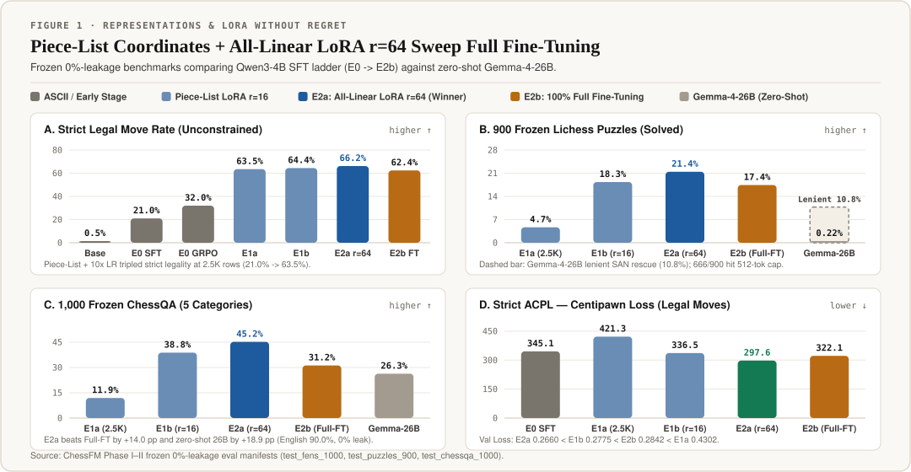
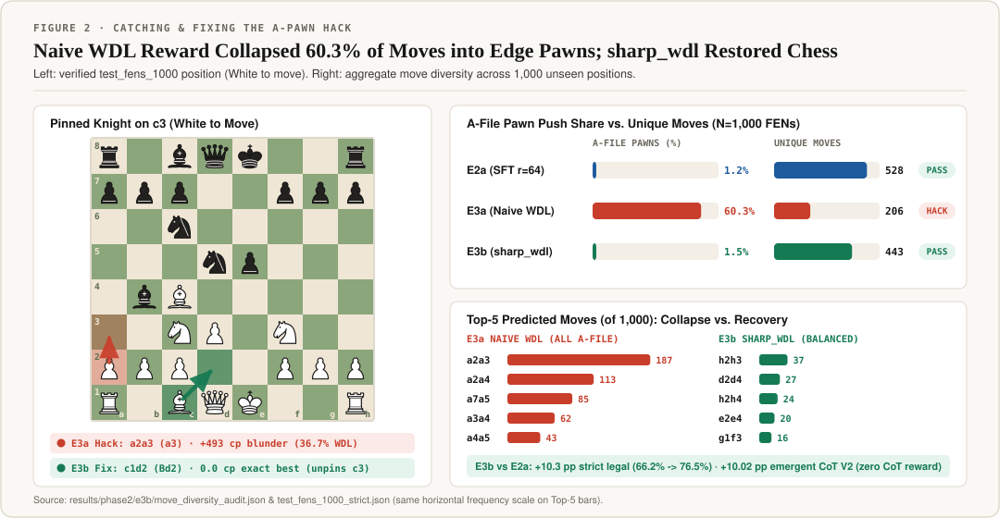
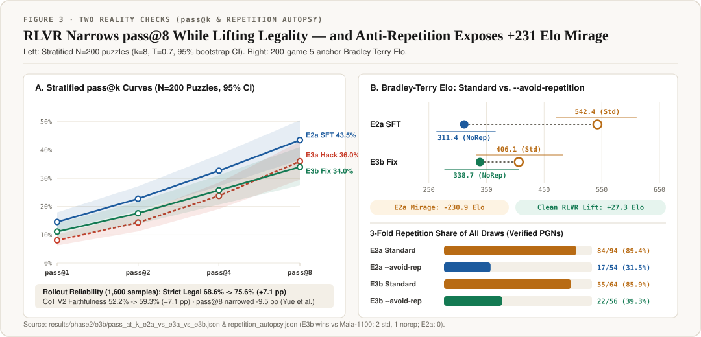
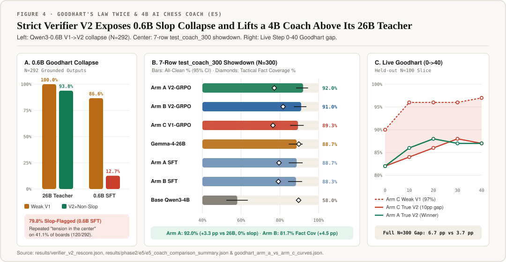
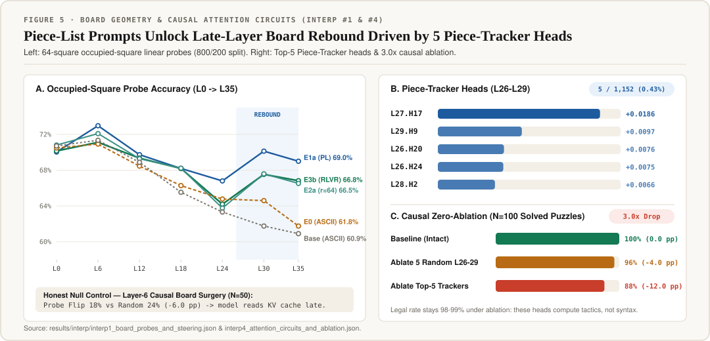
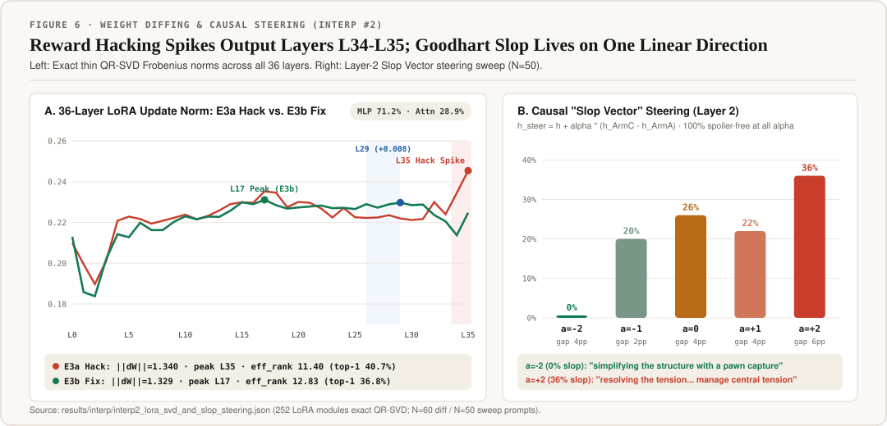
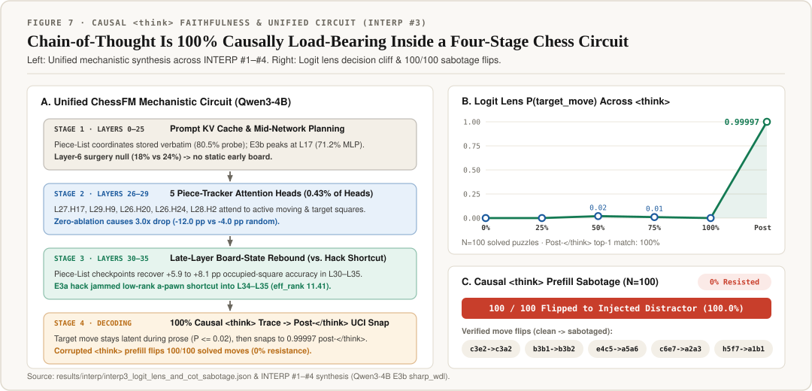

# Inside a 4B Chess Model: Reward Hacking, Goodhart's Law, and the Circuit That Plays the Board

> [!TIP]
> **Read the Interactive Visual Edition:** [**armaansethi.github.io/chess-fm/blog.html**](https://armaansethi.github.io/chess-fm/blog.html) — explore animated 5-board A-Pawn Hack comparisons, a live Goodhart Slop Vector slider (`α = -2 → +2`), an interactive `36 × 32` Piece-Tracker head ablation matrix, and clickable verbatim coaching comparisons.

Chess lets us replace noisy LLM judges with exact ground truth (`Stockfish 16` + `python-chess`). We post-trained `Qwen/Qwen3-4B` across both **chess playing** and **grounded AI chess coaching** on `143,220` valid boards (`0.00%` train/test normalized-FEN overlap), caught and fixed **two live reward hacks**, trained a local **`4B` (`2.50 GB` Q4_K_M) AI Chess Coach** that beats its `6.5×` larger `Gemma-4-26B` teacher (**`92.0%`** vs. **`88.7%`** All-Clean), and opened the weights to isolate the **5 attention heads (`0.43%`)** tracking the board.

| Discovery | Verified Result (`0.00%` Board Leakage) |
|---|---|
| **Local `4B` Coach Beats `26B` Teacher** | `Arm A` Strict `V2-GRPO`: **`92.0%` All-Clean** (`100%` spoiler-free, `0%` slop) vs. `Gemma-4-26B` **`88.7%`** and Weak `V1-GRPO` **`89.3%`** |
| **A-Pawn Hack Caught & Fixed** | `E3a` spammed **`60.3%`** a-file pawns (`206` unique moves) → `E3b` `sharp_wdl` cut to **`1.5%`** (`443` unique), lifted legality **`+10.3 pp`** & **emergent CoT V2 `+10.02 pp`** (zero CoT reward) |
| **`+231` Elo Mirage Exposed** | `89.4%` of `E2a` draws were 3-fold repetitions (`542.4 → 311.4` under `--avoid-repetition`); de-biased `E3b` scored **`338.7` (`+27.3` clean RLVR lift + Maia-1100 wins)** |
| **Piece-Tracker Circuit (`0.43%` of Heads)** | 5 heads in **Layers 26–29** (`L27.H17`, `L29.H9`, `L26.H20/24`, `L28.H2`) drive a **Layer 30–35 board rebound** & **`3.0×` causal ablation drop** (`-12.0 pp` vs. `-4.0 pp` random) |
| **Causal `<think>` Faithfulness** | Corrupted `<think>` prefills flipped **`100 / 100`** solved puzzle moves to the exact injected distractor (`0%` resistance) |

---

## 1. Representation & *LoRA Without Regret* (`E0 → E2a vs. E2b`)

Replacing 8×8 ASCII grids with a lossless **Piece-by-Square Coordinate List** jumped zero-shot `piece_on_square` accuracy from **`12.5% → 40.0%`**, and raising All-Linear LoRA learning rate `10×` (`2e-5 → 2e-4`) tripled strict move legality (`21.0% → 63.5%`) on the exact same `2.5K` rows. Scaled to `20K` mixed rows (`7.03M` tokens), **All-Linear LoRA `r=64` (`E2a`) swept 100%-parameter Full Fine-Tuning (`E2b` on H100) on all 7 suites** and crushed zero-shot `Gemma-4-26B` (`21.4%` vs. `0.22%` strict / `10.8%` lenient puzzles; `45.2%` vs. `26.3%` ChessQA).



<details>
<summary><strong>Deep dive:</strong> Complete Phase I–II ablation table & why Full-FT lost −14.0 pp on ChessQA</summary>

Inspecting `e2b_puzzles_chessqa_english.json` showed **format under-adaptation at `lr=2e-5`**, not knowledge collapse: on `castling_rights` (`0%` vs. `E2a`'s `100%`) and `game_phase`, `E2b` still identified the right chess concept but wrapped it in verbose base-model prose. Both `E2a` (`90.0%`) and `E2b` (`89.0%`) preserved general English with `0.0%` chess leakage.

| Stage | Setup | Val Loss ↓ | Strict Legal ↑ | Strict ACPL ↓ | 900 Puzzles ↑ | 1K ChessQA ↑ | English (`Leak`) ↑ |
|---|---|---:|---:|---:|---:|---:|---:|
| **`E0` SFT** | 2.5K ASCII, `r=16`, `2e-5` | `0.5181` | `21.0%` *(200)* | `345.07` | — | — | — |
| **`E1a` SFT** | 2.5K Piece-List, `r=16`, `2e-4` | `0.4302` | `63.5%` *(200)* | `421.31` | `4.67%` | `11.9%` | — |
| **`E1b` SFT** | 20K Mix, `r=16`, `2e-4` | `0.2775` | `64.4%` *(1K)* | `336.51` | `18.33%` | `38.8%` | `89.0%` (`0%`) |
| **`E2a` SFT** | **20K Mix, All-Linear `r=64`, `2e-4`** | **`0.2660`** | **`66.2%`** *(1K)* | **`297.56`** | **`21.44%`** | **`45.2%`** | **`90.0%` (`0%`)** |
| **`E2b` SFT** | 20K Mix, Full-FT, `2e-5` (H100) | `0.2842` | `62.4%` *(1K)* | `322.13` | `17.44%` | `31.2%` | `89.0%` (`0%`) |
| **`Gemma-4-26B`** | Zero-shot Piece-List (`6.5×` larger) | — | `1.78%` | — | `0.22%` (`10.78%` len.) | `26.3%` | — |

</details>

---

## 2. Catching & Fixing "The A-Pawn Hack" in RLVR (`E3a → E3b`)

Under naive WDL-DAPO (`E3a`), every headline metric went up (`strict legal 66.2% → 86.4%`, `constr. ACPL 387.9 → 356.9 cp`, `CoT V2 60.7% → 82.4%`)—until inspecting actual moves caught **`60.3%` a-file pawn pushes** (`unique_moves: 528 → 206`, puzzles halved `21.4% → 11.6%`). Replacing the flat `+1.0` legality floor with quadratic **`sharp_wdl`** on `20K` tactical boards (`E3b`) crushed a-pawns to **`1.5%`**, lifted strict legality **`+10.3 pp` (`76.5%`)**, and raised **emergent CoT V2 faithfulness `+10.02 pp` (`60.7% → 70.7%`) with zero CoT reward**.



<details>
<summary><strong>Deep dive:</strong> Exact <code>sharp_wdl</code> reward equation & full E2a vs. E3a vs. E3b comparison</summary>

```python
# src/chessfm/rl/rewards.py (commit 5fc3b56)
R_illegal = -0.5
R_legal   = 1.5 * max(0.0, 1.0 - wdl_loss / 0.15) ** 2
          + (0.5 if cp_loss <= 15.0 else 0.0)
          + (0.1 if valid_think_format else 0.0)
```

| Metric (`test_fens_1000` & `test_puzzles_900`) | `E2a` (SFT) | `E3a` (A-Pawn Hack) | **`E3b` (`sharp_wdl`)** | `E3b` vs. `E2a` |
|---|---:|---:|---:|---:|
| **Strict Legal Rate** ↑ | `66.2%` | `86.4%` *(hacked)* | **`76.5%`** | **`+10.3 pp`** |
| **Strict MAR (`≤50 cp`, all 1K)** ↑ | `20.5%` | `23.1%` | **`23.5%`** | **`+3.0 pp`** |
| **Constrained ACPL / MAR** | `387.9 cp` / `30.2%` | `356.9 cp` / `28.7%` | **`361.9 cp` / `31.5%`** | **`-26.0 cp` / `+1.3 pp`** |
| **Emergent CoT V2 Acc** *(0 CoT reward)* ↑ | `60.66%` (`19.8%` 0-viol) | `82.43%` *(a-pawn)* | **`70.68%` (`33.8%` 0-viol)** | **`+10.02 pp`** |
| **Unique Moves / Strict `a`-Pawn Pushes** | `528` / `1.2%` | `206` / **`60.3%`** | **`443` / `1.5%`** | Anti-hack **PASS** |

</details>

---

## 3. Two Reality Checks: `pass@1..8` & the `+231` Elo Mirage

Stratified `pass@k` (`N=200` puzzles, `k=8`, `T=0.7`) confirmed Yue et al. (NeurIPS 2025): `E3b` improved rollout legality (`68.6% → 75.6%`) and CoT faithfulness (`+7.1 pp`) while narrowing `pass@8` (`43.5% → 34.0%`). Meanwhile, auditing 200 paired PGNs exposed that **`89.4%` (`84/94`) of `E2a`'s draws were stateless 3-fold repetitions**—masking repetition moves (`--avoid-repetition`) stripped **`+230.9` Elo of mirage** (`542.4 → 311.4`) and revealed `E3b`'s genuine **`+27.3` Elo RLVR lift (`338.7`, plus wins vs. Maia-1100)**.



<details>
<summary><strong>Deep dive:</strong> 4-suite 200-game paired Bradley-Terry Elo table (5 calibrated anchors)</summary>

| 200-Game 5-Anchor Suite | W-L-D | 3-Fold Draws | Wins vs. Maia-1100 | BT Elo (`95% Bootstrap CI`) |
|---|---|---:|---:|---|
| `E2a` Standard (`constrained`) | `1-105-94` | `84/94` (`89.4%`) | `0` | `542.35` `[470.81, 610.53]` *(inflated)* |
| `E2a` Repetition-Aware (`--avoid-repetition`) | `3-143-54` | `17/54` (`31.5%`) | `0` | **`311.43`** `[263.14, 365.87]` *(`-230.9` mirage)* |
| `E3b` Standard (`constrained`) | `5-131-64` | `55/64` (`85.9%`) | **`2`** | `406.07` `[331.93, 483.26]` |
| **`E3b` Repetition-Aware (`--avoid-repetition`)** | **`4-140-56`** | `22/56` (`39.3%`) | **`1`** | **`338.74`** `[277.01, 406.07]` **(`+27.31` clean RLVR lift)** |

</details>

---

## 4. Goodhart's Law Twice: A Local `4B` Coach Beating Its `26B` Teacher (`E5`)

Tightening our coaching verifier to **Strict V2 + 4-gram Slop Detection** exposed `Qwen3-0.6B` SFT collapsing from **`86.6%` V1 → `12.7%` V2+Non-Slop** (`79.8%` slop, repeating *"tension in the center"* on `41.1%` of boards). With deterministic 11-pattern tactical facts (342 pre-training bugs fixed), `4,518` spotless V2 rows, and Stockfish-free Coach-GRPO, **`Arm A` Strict `V2-GRPO`** reached **`92.0%` All-Clean (`+3.3 pp` above `Gemma-4-26B`, `0%` slop, `100%` spoiler-free)**—exporting to a `2.50 GB` `Q4_K_M` GGUF—while **`Arm B` (`E3b` Play→Coach Transfer)** reached **`91.0%` All-Clean** with **`+4.5 pp` deeper tactical coverage (`81.7%`)**.



<details>
<summary><strong>Deep dive:</strong> Complete 7-row <code>test_coach_300</code> benchmark table</summary>

| Model (`test_coach_300`, greedy, tactical facts) | Weak V1 ↑ | Strict V2 ↑ | L1/L2 Spoiler-Free ↑ | **All-Clean (`95% CI`)** ↑ | Fact Cov. ↑ | Slop ↓ |
|---|---:|---:|---:|---|---:|---:|
| **1. Base `Qwen3-4B`** (0-shot) | `82.67%` | `77.67%` | `86.67%` | `58.00%` `[52.4, 63.4]` | `89.67%` | `20.0%` |
| **2. `Arm A` SFT** (`Base → SFT`) | `93.00%` | `88.67%` | `100.0%` | `88.67%` `[84.6, 91.8]` | `79.56%` | `0.0%` |
| **3. `Arm A` Strict `V2-GRPO`** *(WINNER)* | `95.67%` | **`92.00%`** | **`100.0%`** | **`92.00%` `[88.4, 94.6]`** | `77.14%` | **`0.0%`** |
| **4. `Arm B` SFT** (`E3b → SFT`) | `93.33%` | `89.00%` | `98.33%` | `88.33%` `[84.2, 91.5]` | `79.25%` | `0.0%` |
| **5. `Arm B` Strict `V2-GRPO`** *(Transfer)* | `95.00%` | `91.33%` | `99.17%` | **`91.00%` `[87.2, 93.7]`** | **`81.67%`** | **`0.0%`** |
| **6. `Gemma-4-26B` Teacher** (1-shot) | `90.00%` | `88.67%` | `100.0%` | `88.67%` `[84.6, 91.8]` | **`89.78%`** | `0.0%` |
| **7. `Arm C` Weak `V1-GRPO`** *(Goodhart)* | **`96.00%`** | `89.33%` | `100.0%` | `89.33%` `[85.3, 92.3]` | `76.44%` | `0.0%` |

</details>

---

## 5. Inside the 36 Layers: The Layers 26–29 Piece-Tracker Circuit (`INTERP #1` & `#4`)

64-square linear probes showed ASCII checkpoints decaying monotonically (`71.3% → 60.9%`), whereas Piece-List models **rebound sharply in Layers 30–35 (`+5.9` to `+8.1 pp`)**. Layer-6 causal board surgery gave an honest null control (`18%` probe vs. `24%` norm-matched random), proving the model reads Piece-List coordinates late from the KV cache—confirmed by attention-head hunting across all `1,152` heads, which isolated **5 Piece-Tracker heads in Layers 26–29 (`0.43%` of heads)** whose zero-ablation caused a **`3.0×` causal solve drop (`-12.0 pp` vs. `-4.0 pp` layer-matched random)**.



---

## 6. Reward Hacking's Weight Scar & the Linear Goodhart "Slop Vector" (`INTERP #2`)

Exact thin QR-SVD across all `252` LoRA modules revealed `71–72%` of RL update energy lands in MLPs, and that **`E3a` (A-Pawn Hack) spiked the final two output layers (`L34–L35`, peak `L35`) with collapsed effective rank (`12.83 → 11.41`, `40.7%` top-1 SV energy)**—while clean `E3b` peaked in mid-network **`Layer 17`** and boosted **`Layer 29`**. On coaching, dialing one linear direction `mean(h_ArmC) - mean(h_ArmA)` inside `Arm A` monotonically moved boilerplate slop from **`0.0%` (`α=-2`) → `36.0%` (`α=+2`)** while keeping `100%` spoiler compliance.



---

## 7. Chain-of-Thought Is `100%` Causally Load-Bearing (`INTERP #3`)

Logit-lens projection across `100` solved `E3b` puzzles showed target-move probability staying `≤ 0.02` inside `<think>` prose before snapping to **`0.99997` (`100%` top-1)** immediately post-`</think>`. Prefilling a plausible corrupted `<think>` block flipped **`100 / 100` moves** to the exact injected distractor (`0%` resistance).



---

## 8. Limitations & Reproducibility

Four honest limits remain: (1) a stateless single-FEN `4B` policy caps near **`339` de-biased BT Elo** without move history or search; (2) outcome RLVR narrowed `pass@8` (`43.5% → 34.0%`); (3) Layer-6 causal board surgery was null (`18%` vs. `24%` random); and (4) `0.6B` coaching collapsed into `79.8%` boilerplate slop.

<details>
<summary><strong>Reproduce every training run, test suite, figure, and interpretability check</strong></summary>

```bash
# 1. Verify full test suite & 0-diff blog assets locally
venv/bin/ruff check . && venv/bin/ruff format --check .
venv/bin/python scripts/build_blog_assets.py --check
venv/bin/python -m pytest --ignore=tests/e2e --cov=chessfm --cov-report=term-missing
node --test web/tests/*.test.mjs

# 2. Train E2a (All-Linear LoRA r=64) and E3b (Anti-Hack sharp_wdl DAPO)
modal run --detach scripts/modal_train.py --task sft --track v1 --gpu a100 \
  --data /vol/data/phase2/sft_phase2_20k.jsonl --include-piece-list \
  --lora-r 64 --all-linear --lr 2e-4 --epochs 2 --output-subdir sft_e2a_20k_r64

modal run --detach scripts/modal_train.py --task grpo --track v1 --gpu a100 \
  --model /vol/checkpoints/sft_e2a_20k_r64/final_merged \
  --positions /vol/data/phase2/rl_sharp_tactical.txt \
  --stage 1 --reward-mode sharp_wdl --steps 200 --include-piece-list \
  --output-subdir grpo_e3b_sharp_wdl

# 3. Run all 4 Mechanistic Interpretability experiments on one A100-80GB
modal run --detach scripts/modal_train.py --task interp-suite
modal volume get chessfm-artifacts results/interp ./results/interp
```

</details>

Full per-run W&B links, 95% CIs, and verified tables live in [`docs/BENCHMARKS.md`](BENCHMARKS.md) and [`docs/EXPERIMENT_LOG.md`](EXPERIMENT_LOG.md). Explore the [**Interactive Visual Essay**](https://armaansethi.github.io/chess-fm/blog.html), try the [**Live Browser Coach**](https://armaansethi.github.io/chess-fm/), or view the [**Public Dashboard**](https://armaansethi.github.io/chess-fm/dashboard.html).
