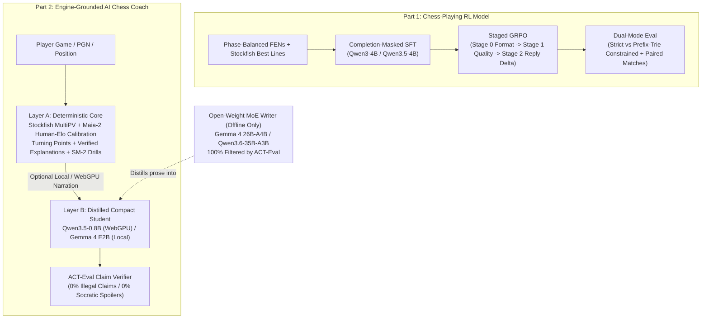

# ChessFM — Architecture & Design Decisions

This document records the core engineering and modeling decisions behind ChessFM (`ADR-001` through `ADR-008`). Its purpose is to make every architectural tradeoff explicit, reproducible, and auditable.

> **Verification status:** Deterministic harnesses, Stockfish-16 baselines, and CPU micro-experiments are verified and reproducible locally (see [docs/BENCHMARKS.md](BENCHMARKS.md) and [docs/EXPERIMENTS.md](EXPERIMENTS.md)). Full GPU training runs (SFT, staged GRPO, and open-weight coaching distillation) are documented below as the execution specification and will be populated in `docs/BENCHMARKS.md` only with measured artifacts and `run_manifest.json` outputs.

---

## System Overview

ChessFM investigates how compact, open-weight language models can reason about chess **without hallucinating**, by coupling symbolic chess engines (`Stockfish` + `Maia-2`) with neural models at both **training time** (verifiable RL rewards and rejection-sampled distillation) and **inference time** (prefix-trie constrained decoding and deterministic claim verification).

---

## ADR-001 — Decoupling Chess Playing (Part 1) from Chess Coaching (Part 2)

- **Decision:** Treat the RL chess-playing model (Part 1) and the engine-grounded Chess Coach (Part 2) as two distinct subsystems sharing the same board/engine verification primitives.
- **Rationale:**
  - Classical alpha-beta/NNUE engines such as Stockfish exceed 3600 Elo in a few megabytes of CPU or WebAssembly compute. Training a 4B language model to play chess is an ideal verifiable-RL research problem (exact reward oracle, unambiguous move legality, rich tactical search space), not a replacement for Stockfish.
  - Conversely, human learners (especially 800–1600 Elo) are poorly served by raw engine output: Stockfish flags complex grandmaster tactics that intermediate players cannot realistically find and provides no pedagogical explanation. Pairing Stockfish truth with Maia-2 human-Elo calibration, 3-level Socratic hints, and deterministic claim verification addresses a concrete coaching problem without pretending an LLM should calculate moves from scratch.

---

## ADR-002 — Part 1 Base Model Selection (`Qwen3-4B` vs. `Qwen3.5-4B`)

- **Decision:** Support both `Qwen/Qwen3-4B` (`v1`) and `Qwen/Qwen3.5-4B` (`v1.5`) as the primary 4B RL backbones (retaining `Qwen/Qwen2.5-3B-Instruct` only as a historical `v0` baseline).
- **Tradeoffs Evaluated:**
  - **`Qwen/Qwen3-4B` (Apache-2.0):** Pure text-only dense Transformer with native `<think>...</think>` alignment. Compatible with both our verified TRL 0.16 harness and TRL/vLLM colocate rollouts, giving fast GRPO iteration speed.
  - **`Qwen/Qwen3.5-4B` (Apache-2.0):** Hybrid Gated DeltaNet + Gated Attention architecture with native `<think>...</think>` reasoning and stronger general reasoning benchmarks. Packaged as a unified vision-language model (`Qwen3_5ForConditionalGeneration`), so text-only GRPO requires `transformers>=5.2` and native generation rather than vLLM colocate.
  - **`google/gemma-4-E4B-it` (Apache-2.0, ungated):** Strong multimodal and prose model suited to local coaching (`v2`), but carries Per-Layer Embeddings and audio/vision encoders (~9 GB memory footprint) unnecessary for FEN/ASCII move-generation RL, and uses `<|channel>thought...<channel|>` rather than `<think>...</think>`.
  - **Older 3B baselines (`Qwen2.5-3B-Instruct`):** Lack native `<think>` pretraining, requiring extra SFT/Stage-0 steps purely to establish formatting.

---

## ADR-003 — Hybrid Thinking Mode & Controlled `Thinking OFF vs. ON` Ablation

- **Decision:** Use hybrid reasoning backbones and explicitly evaluate `enable_thinking=False` against `enable_thinking=True` on identical positions.
- **Rationale:**
  - Modern hybrid models allow toggling internal reasoning chains via `tokenizer.apply_chat_template(..., enable_thinking=...)` (`Qwen3`/`Qwen3.5` emit `<think>...</think>` by default on 4B+; `Gemma 4` defaults to thinking OFF and enables `<|channel>thought...<channel|>` when `<|think|>` is placed in the system prompt).
  - For GRPO, native scratchpad capability avoids spending early RL steps teaching syntax and allows rollouts to explore candidate moves, captures, and counterplay directly.
  - Benchmarking `thinking=False` vs. `thinking=True` on the same checkpoint isolates whether extra test-time reasoning tokens actually lower centipawn loss (ACPL) at 4B scale.

---

## ADR-004 — Completion-Only SFT, Staged Verifiable GRPO, and Dual-Mode Decoding

- **Decision:** Train Part 1 through four explicit stages and report both unconstrained (`strict`) and constrained (`constrained`) evaluation metrics.
- **Verified Engineering Findings** (reproducible via `scripts/run_cpu_experiments.py`, logged in [docs/EXPERIMENTS.md](EXPERIMENTS.md)):
  1. **Completion-Only SFT Masking:** Masking prompt tokens to `-100` prevents wasting **35.85%** of per-example loss tokens on standard FEN prompts and **48.94%** when `--include-ascii` board rendering is enabled (`0 / 40` template-alignment failures).
  2. **Staged Dense GRPO Rewards:** GRPO normalizes advantages within each candidate group (`G = 8`). On 20 benchmark positions with Stockfish 16 (`depth=6`):
     - **Stage 0 (Legality + Format):** `0.0000` within-group legal-move std (`0 / 20` groups with legal variance). Useful strictly for Stockfish-free format and legality bootstrapping.
     - **Stage 1 (+ Stockfish Move Quality):** `0.2626` legal-only std (`20 / 20` groups with variance), `+0.6058` best-vs-worst legal separation.
     - **Stage 2 (+ Opponent-Reply Delta):** `0.6376` legal-only std (`2.43x` Stage 1), `+1.4856` best-vs-worst legal separation (`2.45x` Stage 1), focusing gradient updates on punishing tactical blunders.
  3. **Prefix-Trie Constrained Decoding (`LegalMoveLogitsProcessor`):** Masks illegal UCI continuations after `</think>` at inference time. In Experiment 1, constrained decoding lifted legality from `0.0%` (`0 / 20`) to `100.0%` (`20 / 20`) while reducing mean per-position latency by `-8.54 ms` (`26.25 ms` vs. `34.79 ms`) due to immediate EOS allowance after valid 4–5 token UCI moves. Because constrained decoding guarantees legality at inference time, **both** `strict` Pass@1 and `constrained` modes are reported side by side.

---

## ADR-005 — Layered Zero-Backend Coaching Architecture (Part 2)

- **Decision:** Design the end-user Chess Coach in two progressive layers so core functionality runs instantaneously with zero server inference cost on mobile and desktop:
  - **Layer A (Always-On Deterministic Core):** Client-side `Stockfish` WASM + `Maia-2` INT8 ONNX (`22.7 MB`, MIT) + Lichess/Chess.com public game import + ECO opening classification + SM-2 spaced-repetition blunder drills + deterministic engine-grounded explanations. Requires no API keys, no backend GPU, and no large model download on initial load.
  - **Layer B (Opt-In Local / Desktop WebGPU Neural Coach):** Loads a distilled compact language model (`Qwen3.5-0.8B` for Desktop WebGPU via Transformers.js, or `Gemma 4 E2B` / `E4B` via local Ollama) only when requested, translating verified engine JSON into natural coaching prose and answering follow-up questions.
- **Rationale:** Mobile browser runtimes (notably iOS WebKit) enforce tight per-tab memory limits (~400 MB) and aggressive cache eviction. Keeping Layer A lightweight and deterministic ensures universal mobile reliability while enabling fully offline neural narration on capable hardware.

---

## ADR-006 — Rejection-Sampled Open-Weight Distillation (`Engine -> Writer -> ACT-Eval -> Student`)

- **Decision:** Keep chess calculation 100% inside Stockfish + Maia-2, and use an open-weight Mixture-of-Experts model strictly as an offline prose writer filtered by deterministic verification (`chessfm.data_generation.distill_open_teacher`).
- **Pipeline:**
  1. Stockfish MultiPV + Maia-2 produce structured ground-truth JSON (FEN, best move, principal variation, centipawn drop, rating-calibrated findability).
  2. An open-weight MoE writer (`google/gemma-4-26B-A4B-it` or `Qwen/Qwen3.6-35B-A3B`, both Apache-2.0 and ungated, served locally via vLLM) writes natural postmortem explanations and 3-level Socratic hints grounded strictly in that JSON.
  3. Every candidate passes deterministic rejection sampling: `verify_claims()` must report **0 violations**, and Level 1 / Level 2 Socratic hints must pass `contains_move_spoiler() == False`. Any rejected candidate is discarded and retried.
  4. Compact student models (`Qwen/Qwen3.5-0.8B` for browser WebGPU; `google/gemma-4-E2B-it` for local/Ollama) fine-tune exclusively on verified examples.
- **Rationale:** Fine-tuning a compact model on deterministic Python templates teaches it only to reproduce static templates, while un-tuned sub-1B models frequently hallucinate piece placements and leak hint answers. Sub-350M models remain too weak for grounded multi-sentence explanation; `0.8B`–`2B` distilled on verifier-filtered prose is the practical floor.

---

## ADR-007 — Dual-Image GPU Dependency Strategy

- **Decision:** Keep the core CPU/CI package pinned to the verified `transformers>=4.51.0,<4.52` + `trl>=0.16.0,<0.17` baseline while exposing a `modern` optional extra in `pyproject.toml` and dual container images in `scripts/modal_train.py`:
  - **Stable image (`image`):** Runs `v0` (`Qwen2.5-3B`) and `v1` (`Qwen3-4B`) with verified TRL 0.16 compatibility.
  - **Modern image (`modern_image` / `vllm_image`):** Installs `transformers>=5.2`, `trl>=1.18`, `peft>=0.15`, `wandb`, and `vllm` for `Qwen3.5-*`, `Gemma 4 *`, and high-throughput open-weight distillation.
- **Rationale:** Preserves 100% deterministic CI stability across all 570+ tests while supporting current 2026 model architectures without dependency conflicts.

---

## ADR-008 — Reproducibility, Leakage Prevention & Reporting Discipline

- **Decision:**
  - All train/validation/test splits partition strictly by normalized board FEN (`training/split.py`, `data_generation/phase_sampler.py`) so no position leaks across splits.
  - Every training run writes a structured `run_manifest.json` capturing model ID, stage, seed, hyperparameters, dataset path/hash, GPU hardware, and wall-clock time.
  - All evaluations use the 4-tier harness (`chessfm.eval.suite`): Static Engine Metrics, Board-State Probing (ChessQA), Coaching Faithfulness (ACT-Eval), and Paired Color-Balanced Matches with 95% Wilson confidence intervals.
  - Documentation reports only directly measured, reproducible results.
